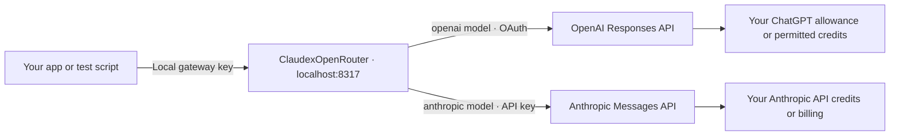
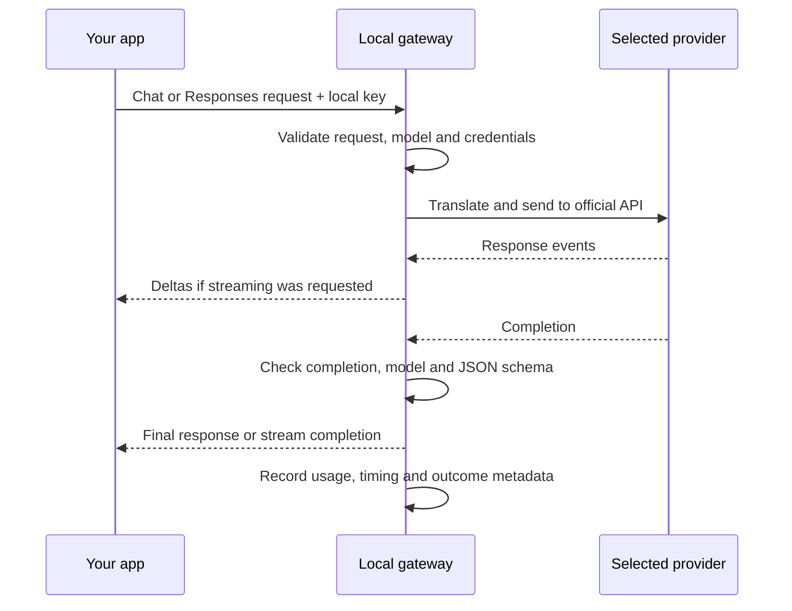

# ClaudexOpenRouter

Test an OpenAI/OpenRouter-compatible app locally using your **ChatGPT plan** or **Anthropic account**, without sending those calls through OpenRouter. Change your client's base URL, key and model; keep your application's prompts and workflow.

Useful for iterating on prompts, structured outputs and model comparisons before paying for production traffic. This is a standalone HTTP gateway, with no application-specific logic.

## Where requests and costs go



**No OpenRouter credits are used by these routes. That does not make every call free.**

| Route | What pays for testing |
| --- | --- |
| OpenAI | Your eligible ChatGPT plan allowance, or credits if you allow them. Manage this app's access in [ChatGPT Settings → Usage](https://chatgpt.com/settings/usage); disable credit use there if you want allowance-only testing. [Account and usage details](https://developers.openai.com/siwc/token-sharing-open-source/profiles-and-sessions). |
| Claude | Your Anthropic Console organization's API balance. Eligible subscribers can [claim included API credits](https://platform.claude.com/docs/en/about-claude/api-credits-for-subscribers); purchased credits or invoiced usage may apply after those run out. Set Console spend controls. This does not reuse Claude Code login credentials. |

Model access and account limits still apply. There is no automatic provider, model or billing fallback.

## 1. Install and start

Requires **Python 3.12+**, [uv](https://docs.astral.sh/uv/), and an eligible ChatGPT connection or Anthropic API key.

```sh
git clone https://github.com/Nerdstorm/ClaudexOpenRouter.git
cd ClaudexOpenRouter
uv sync --frozen
uv run chatgpt-gateway serve
```

Leave that terminal running. The server listens on `127.0.0.1:8317`.
The CLI remains `chatgpt-gateway`.

## 2. Connect a provider

**ChatGPT:** in another terminal, from the same checkout:

```sh
uv run chatgpt-gateway login
uv run chatgpt-gateway status
uv run chatgpt-gateway models
```

Complete **Continue with ChatGPT** in the browser for the app named **ChatGPT Plan Gateway**. Tokens are saved privately and renewed automatically; restarting normally needs no new sign-in.

**Claude, optional:** set `ANTHROPIC_API_KEY` in the server's environment and restart it. Alternatively, store the key in `~/.local/share/chatgpt-plan-gateway/anthropic-api-key` with permissions `0600`. Then run `models` to see supported choices. Claude can run without a ChatGPT login. Clients always use the local gateway key, never this vendor key.

## 3. Point your app at the gateway

| Client setting | Value |
| --- | --- |
| Base URL | `http://127.0.0.1:8317/api/v1` (`/v1` also works) |
| API key | Output of `uv run chatgpt-gateway key` |
| Model | Exact ID returned by `uv run chatgpt-gateway models` |
| Docker Desktop / OrbStack URL | `http://host.docker.internal:8317/api/v1` |
| SDK retries for comparisons | `0`, to avoid hidden repeat calls |

Try one request before running a batch:

```sh
export CHATGPT_GATEWAY_KEY="$(uv run chatgpt-gateway key)"
# Replace this value with an exact ID from the models command.
export GATEWAY_MODEL="EXACT_ID_FROM_MODELS"
uv run python examples/probe.py --model "$GATEWAY_MODEL" --format json
```

The probe prints the answer, served model and usage. It consumes the selected provider's allowance or credits. Existing OpenAI SDK clients can use the same base URL and local key.

## What happens inside



Supports text, JSON schemas and streaming; OpenAI also supports compatible image inputs. Chat Completions serves both providers; Responses is OpenAI-only. **Image generation/editing is not supported.** This is an [explicit compatibility subset](docs/compatibility.md), not every OpenRouter feature.

An OpenAI `401 token_expired` before streaming can renew an eligible token and retry once. Invalid keys, unavailable renewal and a second rejection stop the request. A started stream is never replayed.

## Everyday use

- `status` checks connections; `models` lists choices; `requests` shows outcomes and token usage.
- Keep keys outside Git. Runtime credentials live in `~/.local/share/chatgpt-plan-gateway`; logs exclude prompts, answers and credentials.
- If your client sends OpenRouter's `data_collection=deny`, read the [data-policy settings](docs/configuration.md#openrouter-data-policy-options). These routes use their own account controls and cannot attest that OpenRouter policy.
- To use OpenRouter again, restore `https://openrouter.ai/api/v1` and your OpenRouter key, selecting a model it supports. Those calls use OpenRouter billing.

[Configuration and troubleshooting](docs/configuration.md) · [API compatibility and caching](docs/compatibility.md) · [Detailed architecture](docs/architecture.md)
