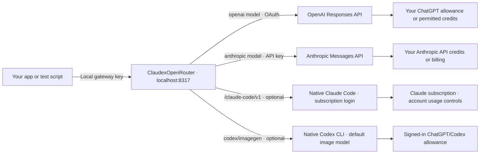
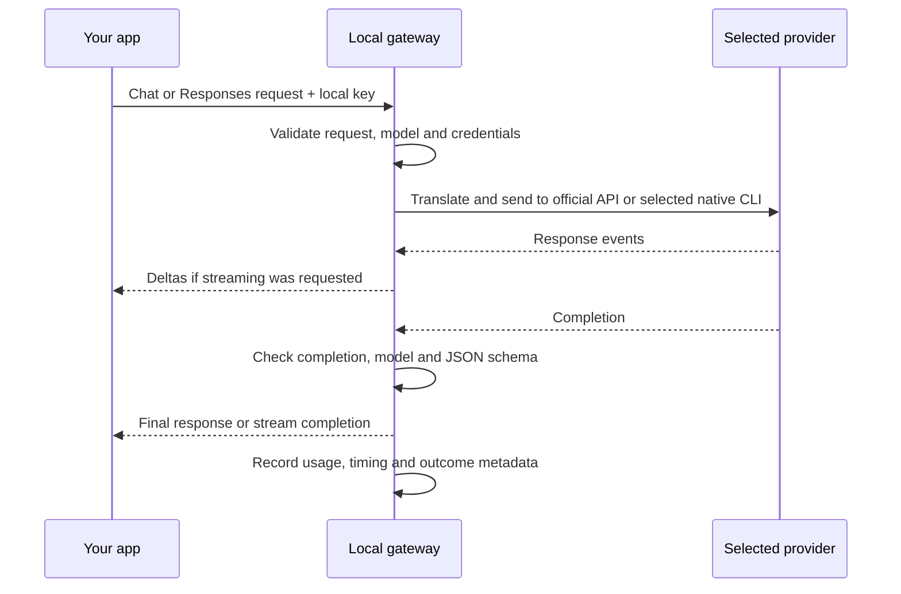

# ClaudexOpenRouter

Test an OpenAI/OpenRouter-compatible app locally using your **ChatGPT plan**, **Anthropic API account**, **Claude subscription**, or **Codex's default image generator**, without sending those calls through OpenRouter. Choose the backend's base URL, local key and supported model. Each backend has an explicit compatibility contract.

Useful for iterating on prompts, structured outputs and model comparisons before paying for production traffic. This is a standalone HTTP gateway, with no application-specific logic.

## Where requests and costs go



**No OpenRouter credits are used by these routes. That does not make every call free.**

| Route | What pays for testing |
| --- | --- |
| OpenAI | Your eligible ChatGPT plan allowance, or credits if you allow them. Manage this app's access in [ChatGPT Settings → Usage](https://chatgpt.com/settings/usage); disable credit use there if you want allowance-only testing. [Account and usage details](https://developers.openai.com/siwc/token-sharing-open-source/profiles-and-sessions). |
| Claude | Your Anthropic Console organization's API balance. Eligible subscribers can [claim included API credits](https://platform.claude.com/docs/en/about-claude/api-credits-for-subscribers); purchased credits or invoiced usage may apply after those run out. Set Console spend controls. This does not reuse Claude Code login credentials. |
| Claude Code subscription, optional | Native Claude Code signed in with your Claude plan. Uses subscription limits; account usage credits may permit paid continuation after those limits. The gateway does not verify that extra usage is disabled. No switch to the API route occurs. [Subscription usage](https://support.claude.com/en/articles/15036540-use-the-claude-agent-sdk-with-your-claude-plan), [usage-credit controls](https://support.claude.com/en/articles/12429409-manage-usage-credits-for-paid-claude-plans). |
| Codex images, optional | Your native Codex connection signed in with ChatGPT. Image tasks count toward Codex usage limits and include agent overhead. No paid Images API fallback is configured. [Codex image usage](https://learn.chatgpt.com/docs/image-generation). |

Model access and account limits still apply. There is no automatic provider, model or billing fallback.

## Supported models and concurrency

| Gateway model ID | Supported use | Selection limits |
| --- | --- | --- |
| `openai/...` IDs returned by `models` | Text, JSON schemas, compatible image **input** and native search | Dynamic catalogue of the connected account. A listing does not guarantee inference access. No image generation on this route. |
| `anthropic/claude-sonnet-5.5`, `anthropic/claude-opus-5.5` on `/api/v1` or `/v1` | Text, JSON schemas, conversation history, streaming and explicit prompt caching | Listed only when configured and returned by the Anthropic catalogue. API key billing. |
| Same two Claude IDs on `/claude-code/v1` | One user message with leading system/developer context; text or validated JSON; no streaming | Optional Claude Code subscription backend. Pins full model IDs and verifies the served model. Discovery lists gateway-supported models after CLI/version/login checks, without claiming account entitlement. CLI manages caching; API cache controls and native assistant history are refused. |
| `codex/imagegen` | Generate or edit one image, with up to five references | Optional **default Codex image model only**. This is a gateway capability alias, not a pinned image-model ID. No selectable Sunburst, Flare, or older GPT Image engines. |

OpenAI text IDs depend on your account: examples from one connected catalogue include
`openai/gpt-6.1-sol`, `openai/gpt-6-astra`, `openai/gpt-6-sol`, `openai/gpt-6-luna`,
`openai/gpt-5.6-sol`, `openai/gpt-5.6-terra` and `openai/gpt-5.6-luna`.
Always use `uv run chatgpt-gateway models` for the current list.
Use `uv run chatgpt-gateway models --backend claude-code` for the separate subscription list.

Codex chooses the image engine; choosing a text model is not a way to switch image engines.
OpenAI currently documents the built-in default as `gpt-image-2`, but this gateway does not
pin or independently verify its engine/snapshot. Discovery and responses say
`image_model: "codex_default"`, `selectable_image_model: false` (discovery), and
`image_model_verified: false`. Image dimensions, quality and background use the tool's defaults;
explicit overrides are rejected. Output is PNG, inline base64, without streaming.

| Limit | Default | Setting |
| --- | --- | --- |
| All model calls combined, across all clients and providers | **12** | `CHATGPT_GATEWAY_MAX_CONCURRENCY` |
| Image tasks within that shared pool | **1** | `CHATGPT_GATEWAY_IMAGE_MAX_CONCURRENCY` |
| Claude Code subscription tasks within that shared pool | **1** | `CHATGPT_GATEWAY_CLAUDE_CODE_MAX_CONCURRENCY` |

An image task occupies one of the 12 shared slots: this is **12 total, including at most
1 image**, not 12 text calls plus another image. The image limit can be raised up to the shared
limit. Busy admission waits up to one second, then returns `429 gateway_busy` with `Retry-After: 1`;
clients own their queues and retry policy. These settings do not increase provider/account quotas.
Inspect effective settings with `uv run chatgpt-gateway capabilities`.
Claude subscription tasks also take one shared slot and one slot from their own nested pool.
Their default cap of one is a conservative local setting, not a measured Claude account limit.

## 1. Install and start

Requires **Python 3.12+**, [uv](https://docs.astral.sh/uv/), and at least one configured backend:
an eligible ChatGPT connection, Anthropic API key, or supported native CLI with its plan login.

```sh
git clone https://github.com/Nerdstorm/ClaudexOpenRouter.git
cd ClaudexOpenRouter
uv sync --frozen
uv run chatgpt-gateway serve
```

Leave that terminal running. The server listens on `127.0.0.1:8317`.
The CLI remains `chatgpt-gateway`.

## 2. Connect a provider

**ChatGPT:** in another terminal, from the same checkout:

```sh
uv run chatgpt-gateway login
uv run chatgpt-gateway status
uv run chatgpt-gateway models
```

Complete **Continue with ChatGPT** in the browser for the app named **ChatGPT Plan Gateway**. Tokens are saved privately and renewed automatically; restarting normally needs no new sign-in.

**Claude, optional:** set `ANTHROPIC_API_KEY` in the server's environment and restart it. Alternatively, store the key in `~/.local/share/chatgpt-plan-gateway/anthropic-api-key` with permissions `0600`. Then run `models` to see supported choices. Claude can run without a ChatGPT login. Clients always use the local gateway key, never this vendor key.

**Claude subscription, optional (macOS/Linux):** install Claude Code **2.1.284 or later**,
then sign in using its native flow:

```sh
uv run chatgpt-gateway claude-login
uv run chatgpt-gateway claude-status
CHATGPT_GATEWAY_CLAUDE_CODE=1 uv run chatgpt-gateway serve
```

Restart the existing gateway with that flag; run only one server for the data directory.
Choose your Claude subscription during login. Claude Code owns and renews its credentials;
the gateway never extracts them. Keep any existing API/image settings when restarting.
Set the client's base URL to **`http://127.0.0.1:8317/claude-code/v1`** to choose this backend.
The existing `/api/v1` and `/v1` routes keep their original API behaviour. This backend runs
a fresh, tool-free Claude Code session per request, so compare it as a harness-backed route,
not as a bare Messages API call. See [subscription compatibility and limits](docs/compatibility.md#claude-code-subscription).

**Codex images, optional (macOS/Linux):** install a recent Codex CLI, run `codex login` and choose ChatGPT
sign-in, then verify `codex login status`. Restart the gateway with:

```sh
CHATGPT_GATEWAY_CODEX_IMAGES=1 uv run chatgpt-gateway serve
```

The image worker uses Codex's own login, independently of `chatgpt-gateway login`; it never
extracts Codex tokens. API-key-only Codex login is refused. The image entry is omitted when
disabled, the executable is missing, or ChatGPT login is unavailable. The capability endpoint
reports the reason. Codex images can run without the gateway's separate ChatGPT/Claude connections.

## 3. Point your app at the gateway

| Client setting | Value |
| --- | --- |
| Base URL | `http://127.0.0.1:8317/api/v1` (`/v1` also works) |
| API key | Output of `uv run chatgpt-gateway key` |
| Model | Exact ID returned by `uv run chatgpt-gateway models` |
| Docker Desktop / OrbStack URL | `http://host.docker.internal:8317/api/v1` |
| SDK retries for comparisons | `0`, to avoid hidden repeat calls |

Try one request before running a batch:

```sh
export CHATGPT_GATEWAY_KEY="$(uv run chatgpt-gateway key)"
# Replace this value with an exact ID from the models command.
export GATEWAY_MODEL="EXACT_ID_FROM_MODELS"
uv run python examples/probe.py --model "$GATEWAY_MODEL" --format json
```

The probe prints the answer, served model and usage. It consumes the selected provider's allowance or credits. Existing OpenAI SDK clients can use the same base URL and local key.

For the enabled Claude subscription backend, these probes use its separate base URL and
print model, validation, timing and usage metadata without printing the answer:

```sh
uv run python examples/claude_subscription_probe.py --model sonnet --format json
uv run python examples/claude_subscription_probe.py --model opus --format json
# Optional generic nested schema with eight definitions and numerical/array/union constraints.
uv run python examples/claude_subscription_probe.py --model sonnet --format large-json
```

Each invocation makes one explicit request and consumes subscription usage; no retries or
quality ranking are implied. `--format text` runs a simple exact-answer check.

For an enabled image worker:

```sh
uv run python examples/image_probe.py --prompt "One blue ceramic mug on white" --output mug.png
# Edit using a local reference, uploaded to the gateway; no remote image fetches.
uv run python examples/image_probe.py --prompt "Make the mug red" --reference mug.png --output red-mug.png
```

Each image probe consumes Codex allowance. It uses `codex/imagegen`, one output and no SDK
retries. See [image request examples and limits](docs/compatibility.md#codex-default-image-generation).

## What happens inside



Supports text, JSON schemas and streaming; OpenAI also supports compatible image inputs.
Chat Completions serves text providers and the optional Codex image subset. Responses is
OpenAI-only. Image generation/editing uses the dedicated native Codex worker, not the public
ChatGPT-plan Responses connection. This is an [explicit compatibility subset](docs/compatibility.md),
not every OpenRouter feature.

An OpenAI `401 token_expired` before streaming can renew an eligible token and retry once. Invalid keys, unavailable renewal and a second rejection stop the request. A started stream is never replayed.

## Everyday use

- `status` checks connections; `models` lists choices; `requests` shows outcomes and token usage.
- Keep keys outside Git. Runtime credentials live in `~/.local/share/chatgpt-plan-gateway`; logs exclude prompts, answers and credentials.
- If your client sends OpenRouter's `data_collection=deny`, read the [data-policy settings](docs/configuration.md#openrouter-data-policy-options). These routes use their own account controls and cannot attest that OpenRouter policy.
- To use OpenRouter again, restore `https://openrouter.ai/api/v1` and your OpenRouter key, selecting a model it supports. Those calls use OpenRouter billing.

[Configuration and troubleshooting](docs/configuration.md) · [API compatibility and caching](docs/compatibility.md) · [Detailed architecture](docs/architecture.md)
