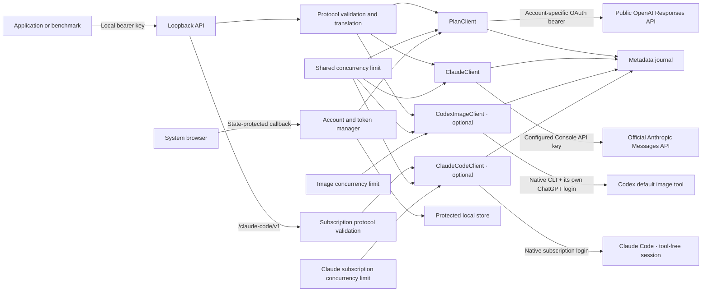

# Architecture

## Request flow

The gateway owns HTTP compatibility, account permissions and transport. Client applications own
prompts, schemas, role assignments, evaluation labels, retries and ordinary tool execution.
No module imports a client application or reads desktop conversations. Default text providers
use APIs directly. Explicit optional backends own bounded native Codex image tasks or Claude
Code text sessions; native clients retain ownership of their own credentials.

## Responsibilities

| Module | Responsibility |
| --- | --- |
| `config.py` | Loopback settings and fixed official endpoints |
| `storage.py` | Atomic private account records, stable host identity, active selection, metadata journal |
| `auth.py` | Public-client registration, PKCE/state/nonce, signed identity validation, granted scopes, serialized renewal and sign-out |
| `protocol.py` | Supported request subset, Chat-to-Responses translation, JSON-schema validation, response conversion |
| `anthropic_protocol.py` | Explicit OpenRouter-to-Claude model mapping, portable cache controls, schema transformation, native usage normalization |
| `anthropic_upstream.py` | Real Anthropic catalogue, no-retry SDK transport, terminal/model validation, provider-labelled cache/latency journal |
| `claude_code_protocol.py` | Explicit subscription text/JSON subset; reject unsupported history/cache/stream semantics |
| `claude_code.py` | Native subscription readiness, exact model/provenance checks, one-turn completion, nested/shared admission and usage |
| `native_process.py` | Native process-group termination and descendant cleanup |
| `image_protocol.py` | Default-image capability alias, strict image request subset and validated reference formats |
| `codex_images.py` | Native ChatGPT-authenticated CLI worker, readiness, nested admission, bounded subprocess lifecycle, current-thread artifacts and actual agent usage |
| `upstream.py` | Account catalog, model admission, bounded concurrency, public HTTP/SSE, terminal validation and journal outcomes |
| `app.py` | Local authentication, host/origin boundary, body limits, routes and streaming adaptation |
| `cli.py` | Server lifecycle, browser sign-in and local management commands |
| `static/` | Callback page markup and shared stylesheet |

## Authorisation and renewal

A first sign-in uses `dynamic_agent_client`, the application's name, a persistent opaque host ID, and fresh state, nonce and PKCE verifier. Each pending attempt expires after ten minutes. The callback consumes state once, uses the issued client ID for code exchange, and validates the ID token against OpenAI's discovery/JWKS, issuer, audience, expiry and nonce.

Only a verified identity becomes an account record. Identity alone does not enable inference: `chatgpt.tokens.use.direct` must be granted. Records are keyed by issuer, issued client ID and verified subject, keeping same-email registrations separate. A returning sign-in must match the selected verified subject and client ID before replacing credentials.

If a first code exchange reports `invalid_grant`, the issued ID is retained separately in memory for a fresh ordinary `login` attempt. It never becomes an inference credential or replaces the active account. This unverified retry registration disappears on restart; verified registrations persist. `login --new` explicitly starts another registration.

The service renews tokens near expiry under a single async lock. A model-list or inference HTTP `401 token_expired` also requests renewal when the issuer’s `earliest_refresh_at` permits it, then repeats that rejected request once only if the token changed. The retry uses the same request body and account; a second rejection is terminal. Concurrent rejections reuse an already rotated token and never change accounts. A successful refresh replaces access token, rotating refresh token, scopes and expiry together. A process lock prevents two servers from racing the same saved token. Terminal refresh failures clear unusable tokens while preserving the issued registration; temporary failures preserve the token set. Sign-out attempts remote revocation, then clears locally and reports whether revocation was confirmed.

Official contracts: [sign-in](https://developers.openai.com/siwc/token-sharing-open-source/sign-in), [accounts and sessions](https://developers.openai.com/siwc/token-sharing-open-source/profiles-and-sessions), and [token reference](https://developers.openai.com/siwc/token-sharing-open-source/token-reference).

## Inference lifecycle

After local validation, the server acquires a concurrency slot, obtains renewable credentials, and checks the exact model against the selected account's catalog. Catalogues used for inference are cached for 60 seconds per registration. On a temporary listing failure (transport, 408/429/selected 5xx or `401 token_expired`), an existing same-registration list may be used for at most five minutes from its successful fetch, with subsequent listing attempts spaced 15 seconds apart. A failure never extends that age. Explicit external model-list requests remain fresh and report errors. Definite grant/authorization errors discard the cache. A listing is not an access guarantee: the exact requested model must be on that list and inference still authenticates upstream.

Every OpenAI upstream inference uses `POST https://api.openai.com/v1/responses`, `store:false`, and `stream:true`. The client sends all required history. Nonstreaming clients receive an object only after `response.completed`; streaming clients receive events/chunks, and a finish marker is emitted only after validated completion. JSON-format requests are checked locally at completion. Refusals retain their own representation.

The live plan route has returned valid SSE bodies without a `Content-Type` header. When that header is absent, the gateway parses the body as SSE and still requires the same validated terminal event. A supplied media type must be `text/event-stream` (case-insensitive, with optional parameters); empty, incomplete or malformed bodies still fail.

The route has also returned an empty terminal `output` list after supplying the finished message in `response.output_item.done`. The transport retains those finished items per request, orders them by `output_index`, and fills an absent/empty terminal list before model/schema validation and downstream delivery. Partial deltas and added-but-unfinished items are never used for that recovery. A valid `response.completed` with status `completed` is still required; explicit terminal output is preserved when supplied.

HTTP errors preserve upstream status, body shape, code, parameter, retry hint and request ID where supplied. Known plan errors inside SSE use the statuses documented by OpenAI. Interrupted, incomplete, malformed or mismatched-model results fail. Only an HTTP `401 token_expired` rejection before streaming may trigger the single authentication retry described above. Once a stream starts, errors and partial output never trigger a replay. Invalid keys, permission errors and transport failures are returned without gateway retries. The existing overall timeout covers renewal and the retry; there is no model fallback.

Admitted attempts have a `started` event and a terminal `completed`, `failed` or `interrupted` event with actual model, elapsed time, request ID and usage when available. Credential/model preflight failures are returned to the caller and recorded as `preflight_failed`, without a `started` event or a claim that inference ran. Validation failures are not recorded as model executions. Response usage remains unknown when the upstream omits it.

## Claude routing, caching and billing

The default Chat endpoint selects the Claude API only for an explicit supported `anthropic/...` model id. Claude API credentials are configured independently from renewable ChatGPT credentials. They are read from the server environment or an owner-only key file, never from Claude Code, browser cookies or desktop storage. This API backend uses no agent harness. `GET /models` combines the real configured-provider catalogues; Claude can operate without a ChatGPT login. A failing configured-provider catalogue is reported rather than silently replaced. All backends acquire the same global semaphore, so enabling more providers does not multiply the shared limit.

`ClaudeClient` uses the official Anthropic SDK with retries disabled and the shared HTTP client, serving `POST https://api.anthropic.com/v1/messages`. The gateway accepts only the documented text/schema subset. A required output ceiling is explicit per request or supplied by the disclosed Claude default. The SDK reconstructs messages; the gateway additionally requires message start/delta/stop, complete content blocks, exact model identity and an accepted stop reason. Truncation, fallback/tool blocks, wrong models and interrupted streams fail. Stream errors with HTTP 200 must never turn into a successful response. Refusals are returned separately and journalled as `refused`.

Internally, finalized Claude output is normalized into the same small response/event shape used by the existing Chat adapter. `/v1/responses` remains OpenAI-only; this internal reuse does not claim Anthropic Responses API parity. Anthropic's supported schema transformation is used while retaining the original schema for local validation, so unsupported native numerical/string constraints still matter to acceptance.

Explicit OpenRouter caching markers and TTLs are preserved. The optional default marks only the final leading system/developer block when the caller has supplied no cache controls; it never parses application text, reorders messages, pads prompts, caches changing user suffixes or adds warm-up calls. Root-level null and the server's `off` setting disable this default. First-response availability, exact prefixes, minimum sizes and TTLs still determine actual cache reuse. Native fresh/read/write tokens are normalized without double counting, and missing fields remain unknown. Journal metadata includes provider, API billing source, cache TTL policy, time to first text and total duration, without prompt/schema/answer content.

API keys charge the linked Console organization. Eligible included credits may cover those calls, but the gateway cannot verify balances or stop precisely at the boundary between promotional and purchased credits. Console workspace limits and billing settings control that. This is not a fallback from OpenAI: the caller explicitly selected a Claude model and its Anthropic API route. Provider-specific OpenRouter data-policy exceptions are independent and off by default. Switching a client to OpenRouter changes URL/key, provider billing and potentially cache warmth, while preserving supported client-side request shapes.

Contracts: [Anthropic structured outputs](https://platform.claude.com/docs/en/build-with-claude/structured-outputs), [streaming](https://platform.claude.com/docs/en/build-with-claude/streaming), [prompt caching](https://platform.claude.com/docs/en/build-with-claude/prompt-caching), and [OpenRouter cache controls](https://openrouter.ai/docs/guides/best-practices/prompt-caching).

## Separate native Claude subscription backend

`/claude-code/v1` selects the optional subscription backend explicitly; no model-ID ambiguity
or automatic API fallback is introduced. `ClaudeCodeClient` invokes the documented native
CLI with subscription authentication, a fresh session, replaced system context, no tools/MCP,
safe mode and empty settings. Its own cap defaults to one within the shared twelve. Timeout,
disconnect, invalid output and quota failures terminate the process group and release slots.
The same process cleanup helper serves both native workers; neither imports the other provider.

Protocol validation reuses common Claude Chat checks, but independently refuses unsupported
stream/history/cache semantics. The CLI owns automatic caching, authentication and token renewal.
Credentials and API-key/provider environment overrides are excluded. Every execution freshly
checks native subscription auth, then verifies exact session/assistant/modelUsage provenance,
one completed answer turn and original local JSON validation. Native API retry events stop the
task; there is no gateway inference retry. Model discovery advertises supported pins after
readiness checks, not an upstream subscription catalogue or a guarantee of model access.

The response and journal label the native contract, CLI-managed cache policy, subscription
route, actual usage, turns and retry events. Raw CLI streams, prompt/schema files and answers
are not persisted by the gateway. Native account usage-credit controls can allow paid
continuation; subscription routing is not proof that extra usage is disabled or cash spend
is zero. Details and limits: [configuration](configuration.md#native-claude-subscription-worker)
and [compatibility](compatibility.md#claude-code-subscription).

## Local files and lifecycle

The default data directory is `~/.local/share/chatgpt-plan-gateway` with mode `0700`:

- `host.json`: stable host ID and local API key (`0600`).
- `accounts/<opaque-id>.json`: verified identity, issued registration and tokens (`0600`).
- `active.json`: selected account (`0600`).
- `requests.jsonl`: append-only inference metadata (`0600`).
- `state.lock`: serializes atomic state writes.
- `gateway.lock`: held for the running service's lifetime.
- `anthropic-api-key`: optional user-supplied Claude Console key (`0600`); an environment key or explicit external key-file path may be used instead.

These files are local runtime data, not a database or source-controlled configuration. They are not encrypted at rest; protection is the operating-system user boundary and file permissions. No code reads desktop authentication or browser cookies. Logs exclude request/answer content and credentials; HTTP access logs remain off to protect OAuth codes.

The checkout can live in any directory. Its virtual environment belongs to that checkout; after relocating it, recreate the environment with `uv venv --clear --python 3.12 .venv` and `uv sync --frozen`. Runtime accounts and keys remain in the separate data directory.

The service currently runs in the foreground. Start it from the checkout with `uv run chatgpt-gateway serve`; no launch agent or automatic startup is installed.
