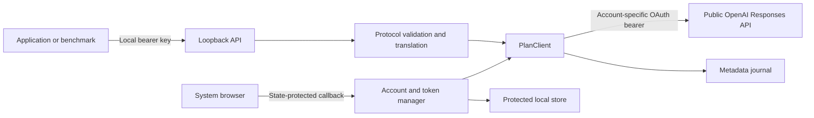

# Architecture

## Request flow

The gateway owns HTTP compatibility, account permissions and transport. Client applications own prompts, schemas, role assignments, evaluation labels, retries and tool execution. No module imports Recipe Designer or any other application. There is no background agent harness and no access to desktop conversations.

## Responsibilities

| Module | Responsibility |
| --- | --- |
| `config.py` | Loopback settings and fixed official endpoints |
| `storage.py` | Atomic private account records, stable host identity, active selection, metadata journal |
| `auth.py` | Public-client registration, PKCE/state/nonce, signed identity validation, granted scopes, serialized renewal and sign-out |
| `protocol.py` | Supported request subset, Chat-to-Responses translation, JSON-schema validation, response conversion |
| `upstream.py` | Account catalog, model admission, bounded concurrency, public HTTP/SSE, terminal validation and journal outcomes |
| `app.py` | Local authentication, host/origin boundary, body limits, routes and streaming adaptation |
| `cli.py` | Server lifecycle, browser sign-in and local management commands |
| `static/` | Callback page markup and shared stylesheet |

## Authorisation and renewal

A first sign-in uses `dynamic_agent_client`, the application's name, a persistent opaque host ID, and fresh state, nonce and PKCE verifier. Each pending attempt expires after ten minutes. The callback consumes state once, uses the issued client ID for code exchange, and validates the ID token against OpenAI's discovery/JWKS, issuer, audience, expiry and nonce.

Only a verified identity becomes an account record. Identity alone does not enable inference: `chatgpt.tokens.use.direct` must be granted. Records are keyed by issuer, issued client ID and verified subject, keeping same-email registrations separate. A returning sign-in must match the selected verified subject and client ID before replacing credentials.

If a first code exchange reports `invalid_grant`, the issued ID is retained separately in memory for a fresh ordinary `login` attempt. It never becomes an inference credential or replaces the active account. This unverified retry registration disappears on restart; verified registrations persist. `login --new` explicitly starts another registration.

The service renews tokens near expiry under a single async lock. A successful refresh replaces access token, rotating refresh token, scopes and expiry together. A process lock prevents two servers from racing the same saved token. Terminal refresh failures clear unusable tokens while preserving the issued registration; temporary failures preserve the token set. Sign-out attempts remote revocation, then clears locally and reports whether revocation was confirmed.

Official contracts: [sign-in](https://developers.openai.com/siwc/token-sharing-open-source/sign-in), [accounts and sessions](https://developers.openai.com/siwc/token-sharing-open-source/profiles-and-sessions), and [token reference](https://developers.openai.com/siwc/token-sharing-open-source/token-reference).

## Inference lifecycle

After local validation, the server acquires a concurrency slot, obtains renewable credentials, and checks the exact model against the selected account's catalog. Catalogs used for inference are cached for 60 seconds per registration; external model-list requests refresh them. A listing is not an access guarantee.

Every upstream inference uses `POST https://api.openai.com/v1/responses`, `store:false`, and `stream:true`. The client sends all required history. Nonstreaming clients receive an object only after `response.completed`; streaming clients receive events/chunks, and a finish marker is emitted only after validated completion. JSON-format requests are checked locally at completion. Refusals retain their own representation.

HTTP errors preserve upstream status, body shape, code, parameter, retry hint and request ID where supplied. Known plan errors inside SSE use the statuses documented by OpenAI. Interrupted, incomplete, malformed or mismatched-model results fail. There is no automatic inference retry or model fallback.

Admitted attempts have a `started` event and a terminal `completed`, `failed` or `interrupted` event with actual model, elapsed time, request ID and usage when available. Credential/model preflight failures are returned to the caller before a journal attempt begins. Validation failures are not recorded as model executions. Response usage remains unknown when the upstream omits it.

## Local files and lifecycle

The default data directory is `~/.local/share/chatgpt-plan-gateway` with mode `0700`:

- `host.json`: stable host ID and local API key (`0600`).
- `accounts/<opaque-id>.json`: verified identity, issued registration and tokens (`0600`).
- `active.json`: selected account (`0600`).
- `requests.jsonl`: append-only inference metadata (`0600`).
- `state.lock`: serializes atomic state writes.
- `gateway.lock`: held for the running service's lifetime.

These files are local runtime data, not a database or source-controlled configuration. They are not encrypted at rest; protection is the operating-system user boundary and file permissions. No code reads desktop authentication or browser cookies. Logs exclude request/answer content and credentials; HTTP access logs remain off to protect OAuth codes.

The standalone Git checkout lives at `~/src/chatgpt-plan-gateway`, alongside other projects rather than inside the Smartmeals workspace. Its virtual environment belongs to that checkout; after relocating it, recreate the environment with `uv venv --clear --python 3.12 .venv` and `uv sync --frozen`. Runtime accounts and keys remain in the separate data directory.

The service currently runs in the foreground. Start it from the checkout with `uv run chatgpt-gateway serve`; no launch agent or automatic startup is installed.
